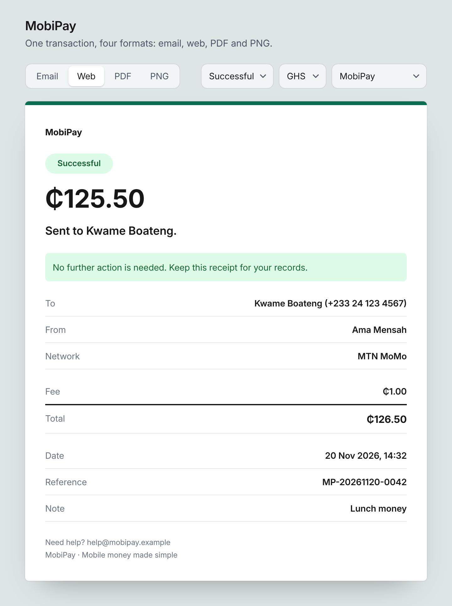
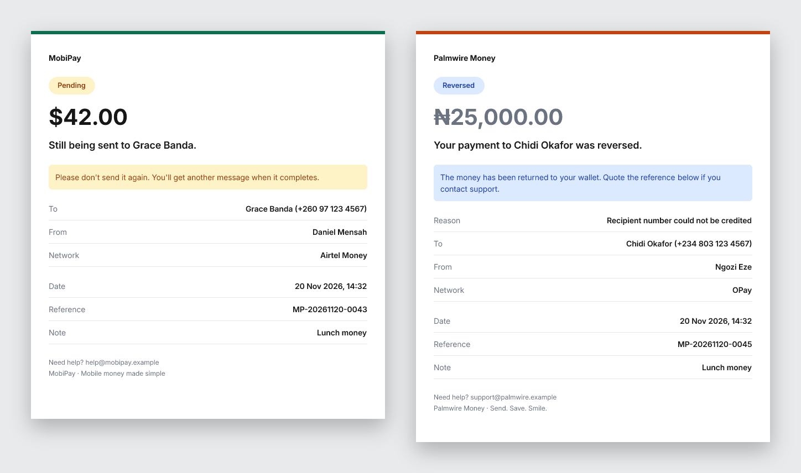

# MobiPay

One mobile money receipt, rendered as an **email, web page, PDF and PNG** from a single `Transaction`. Built with Hyper Elements for the Hyper Elements Template Challenge.

**Live demo: https://iaminiunam.github.io/mobipay/**


## What it does

- **One transaction, four outputs.** Email (HTML and plain text), web page, PDF and PNG all come from the same receipt definition.
- **Wording follows the status.** Successful, pending, failed and reversed each get their own summary line and next-step callout. Failed and reversed receipts show a reason and mute the amount. Recorded debits and refunds are shown explicitly; an unknown amount is never treated as zero.
- **Mobile money context.** Network (MTN MoMo, OPay), recipient number, amounts stored in minor units and shown as ₵ (GHS), ₦ (NGN) or $ (USD).
- **Brandable.** A `Brand` is a name, an accent colour, a support contact and a footer line. Two samples are included: MobiPay and the fictional Palmwire Money.

## Try the demo

Choose a status, currency and brand, then switch between Email, Web, PDF and PNG. Email and web previews render live; the download links use matching pre-generated samples. Email includes HTML and plain-text downloads. PDF includes a direct open link for browsers that cannot embed a PDF viewer.

The demo handles loading and preview errors, and downloads have filenames that identify the brand, currency and status.

## Screenshots



The four statuses (MobiPay, GHS):


Another brand and currency (MobiPay in USD, Palmwire Money in NGN):



## How Hyper Elements is used

The receipt body is written once, in `src/receipt/body.ts`, as a function of the transaction, the brand and a font family. It is built from Hyper Elements components (`Column`, `Row`, `Heading`, `Text`). Each output wraps that same body in a different root component, and a renderer turns it into a file:

| Output | Root component | Renderer | Result |
| --- | --- | --- | --- |
| Email | `Email` (600 px) | `render()` from `@hyper-elements/react` | `{ html, text }` |
| Web page | `Page` | `render()` | `{ html, text }` |
| PDF | `Document` | `renderPdf()` from `@hyper-elements/react/pdf` | PDF bytes |
| PNG | `Canvas` (640 px wide) | `renderImage()` from `@hyper-elements/react/image` | PNG bytes |

```ts
// src/receipt/outputs.ts
export const emailReceipt = (t: Transaction, brand: Brand = mobipayBrand) =>
  h(Email, { width: 600 }, receiptBody(t, brand, WEB_FONT));

export const pdfReceipt = (t: Transaction, brand: Brand = mobipayBrand) =>
  h(Document, null, receiptBody(t, brand, FILE_FONT));
```

```ts
// scripts/render-receipt.ts
const email = await render(emailReceipt(t, brand));
const { pdf } = await renderPdf(pdfReceipt(t, brand), { fonts });
const { image } = await renderReceiptImage(t, brand, { fonts });
```

`render()` also runs in the browser, which is how the demo draws the email and web receipts live. The PDF and PNG renderers need Node, so those files are pre-rendered by `scripts/render-receipt.ts` and committed in `public/previews/` (2 brands × 3 currencies × 4 statuses = 24 receipts).

Things worth knowing if you build on this:

- Style props that work in every output (email HTML, PDF, PNG): `backgroundColor`, `height`, `borderRadius` and `padding` on `Column`; percentage widths on `Row` and `Column`; `textAlign` on `Text`.
- Some props are silently ignored: `alignSelf`, `textDecoration`, and the colour and thickness props on `Divider`. Hairline rules here are thin `Column`s with a background colour.
- A `Canvas` is transparent unless you give it `style={{ backgroundColor }}`, so the PNG sets white explicitly.
- `renderImage(..., { strict: true })` throws, with the pixel amount, when content would be cut off. `renderReceiptImage()` uses `layoutImage()` with the actual fonts to measure the receipt before rendering the PNG at its content height.
- PDF and PNG fonts must be TTF, OTF or WOFF files (not WOFF2) passed to the renderer. Email and web use the font stack `Inter, Arial, Helvetica, sans-serif`.

## Project structure

```
src/
  App.tsx              demo page: output tabs, status / currency / brand selects
  index.css            demo page styles
  receipt/
    types.ts           Transaction, TransactionStatus, Currency, Brand
    brands.ts          the two sample brands
    sample.ts          one sample transaction per status and currency (not FX conversion)
    format.ts          money and date formatting
    status.ts          per-status wording
    theme.ts           colours and status styles
    body.ts            the receipt, built from Hyper Elements components
    outputs.ts         emailReceipt, pageReceipt, pdfReceipt, imageReceipt
    image.ts           Node-only PNG export, measured using actual font metrics
scripts/
  render-receipt.ts    renders PDF and PNG (and email/web files) into public/previews
public/previews/       pre-rendered receipts, one folder per brand / currency / status
fonts/                 Inter TTFs used by the PDF and PNG renderers
```

## Run it locally

You need Node 22 and npm. On Windows, use Git Bash (or `npm.cmd` in PowerShell).

```bash
git clone https://github.com/iamIniunam/mobipay.git
cd mobipay
npm ci
npm run dev
```

Open the URL Vite prints (`http://localhost:5173/mobipay/`).

Other scripts: `npm run build`, `npm run preview`, `npm run lint` and `npm test`. Tests cover debit wording, partial and unknown refunds, timestamps, sample currencies, optional details and long-content exports.

To regenerate every PDF, PNG and email/web file:

```bash
npm run render
```

## Make it your own

- **New brand:** add a `Brand` to `src/receipt/brands.ts` and include it in `brands`.
- **New currency:** extend `Currency` in `types.ts`, then add its symbol in `format.ts` and sample amounts in `sample.ts`.
- **New wording:** edit `STATUS_COPY` in `status.ts`.

Then regenerate the previews with the command above.

## Transaction facts

`amountMinor` is the requested payment amount; `feeMinor` is the payment fee. Supply `debitedMinor` from the wallet record to show **Total debited**. A failed status alone does not establish whether money was debited.

`createdAt` is initiation time. Supply `completedAt` or `reversedAt` when available; the receipt labels the appropriate event near the status and formats every timestamp in UTC.

For a reversed payment, `refundedAmountMinor` and `refundedFeeMinor` record the confirmed principal and fee returned. A zero is confirmed zero; an omitted field is unknown. **Total refunded** is shown only when both parts are known, so a partial refund or retained fee is represented accurately. The currency selector switches fictional sample scenarios; it does not convert real transactions.

For PNG exports, import `renderReceiptImage` from `src/receipt/image.ts` in Node. It measures the shared body with the supplied fonts and returns the fitted image. `imageReceipt()` is the underlying measuring canvas, not the fitted export.

## Deployment

Pull requests run lint, receipt tests, all 24 export variants and the production build. Pushing to `main` runs the same checks in `.github/workflows/deploy.yml`, regenerates every preview, and uploads the built site. A separate deployment job publishes that completed artifact to GitHub Pages. The site lives under `/mobipay/`, so `vite.config.ts` sets `base: '/mobipay/'` and the demo reads preview files through `import.meta.env.BASE_URL`. If you fork under another name, change `base`.

## Notes

- Brands, people, phone numbers and email addresses are fictional.
- Inter is not embedded in the email HTML, so email clients without Inter fall back to Arial. The demo page links Inter into its preview frame.
- Project source is licensed under [MIT](LICENSE).
- Inter is licensed under the SIL Open Font License 1.1; the copyright notice and full license are included in [fonts/OFL.txt](fonts/OFL.txt) and the deployed font folder.