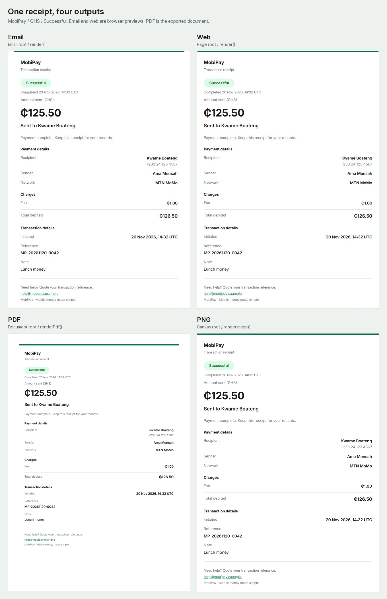

# MobiPay

A mobile money receipt template that renders an **email, web page, PDF and PNG** from one `Transaction` and one shared Hyper Elements body. It handles successful, pending, failed and reversed payments, with wording that explains what happened and what the sender should do next.

[Live demo](https://iaminiunam.github.io/mobipay/) · [Sample PDF](https://iaminiunam.github.io/mobipay/previews/mobipay/GHS/successful/receipt.pdf) · [Sample PNG](https://iaminiunam.github.io/mobipay/previews/mobipay/GHS/successful/receipt.png)


## What it does

- **One receipt, four outputs.** Email includes HTML and plain text. Web, PDF and PNG use the same receipt body.
- **Status-specific wording.** Pending payments discourage duplicate transfers. Failed payments confirm that nothing was debited only when the data records a zero debit. Reversed payments show confirmed principal and fee refunds separately.
- **Useful receipt details.** Recipient name and number, sender, network, fees, reference, note and timestamps. Initiation, completion and reversal are separate events; every displayed time is labelled UTC.
- **Mobile money samples.** MTN MoMo and OPay examples, with GHS, NGN and USD amounts stored in minor units. The currency selector changes fictional sample scenarios; it does not perform currency conversion.
- **Brand settings.** Name, accent colour, support contact and footer text. Two sample brands are included, with a support link that puts the reference in the email subject.

## See the outputs

The same successful transaction in each format. Email and web are browser previews; the PDF image comes from the exported document.

[](docs/formats.png)

More screenshots: [all four statuses](docs/statuses.png), [brand and currency variants](docs/variants.png), [phone layout](docs/mobile.png), and [full demo page](docs/hero.png).

In the [demo](https://iaminiunam.github.io/mobipay/), choose a status, currency and brand, then switch formats. Download the matching HTML, plain text, PDF or PNG. A direct PDF link is available when the browser cannot display the embedded viewer.

## How Hyper Elements is used

[`src/receipt/body.ts`](src/receipt/body.ts) defines the receipt with `Column`, `Row`, `Heading`, `Text` and `Link`. The transaction, brand and font family are inputs to that function. Each output wraps the body in its own root:

| Output | Root | Renderer | Result |
| --- | --- | --- | --- |
| Email | `Email` (600 px) | `render()` | HTML and plain text |
| Web | `Page` (640 px) | `render()` | HTML |
| PDF | `Document` (A4) | `renderPdf()` | PDF bytes |
| PNG | `Canvas` (640 px) | `layoutImage()`, then `renderImage()` | PNG bytes fitted to the content |

The wrappers are in [`outputs.ts`](src/receipt/outputs.ts). [`renderReceiptImage()`](src/receipt/image.ts) measures the body using the supplied fonts before creating the final PNG, with strict overflow checking enabled.

```ts
// scripts/render-receipt.ts loads the fonts and runs this for every sample.
const email = await render(emailReceipt(t, brand));
const { pdf } = await renderPdf(pdfReceipt(t, brand), { fonts });
const { image } = await renderReceiptImage(t, brand, { fonts });
```

`render()` runs in the browser for the live email and web previews. The PDF and PNG renderers run in Node. Downloads use the pre-generated files in `public/previews/`: 2 brands × 3 currencies × 4 statuses = 24 sample combinations, each with email HTML, plain text, web HTML, PDF and PNG files.

## Run it locally

Use Node 22 and npm. In PowerShell, use `npm.cmd` if `npm` is blocked by the shell's execution policy.

```bash
git clone https://github.com/iamIniunam/mobipay.git
cd mobipay
npm ci
npm run dev
```

Open the URL Vite prints, usually `http://localhost:5173/mobipay/`.

| Command | Purpose |
| --- | --- |
| `npm run render` | Regenerate all 24 sample combinations |
| `npm test` | Check transaction wording, refund totals, timestamps and long-content exports |
| `npm run lint` | Run ESLint |
| `npm run build` | Type-check and create the production site |
| `npm run preview` | Serve the production build locally |

## Make it your own

- Add a brand in [`brands.ts`](src/receipt/brands.ts). Include it in `brands` for the demo and export script.
- Supply your own [`Transaction`](src/receipt/types.ts) to an output function, or edit [`sample.ts`](src/receipt/sample.ts) to change the demo scenarios.
- Edit [`status.ts`](src/receipt/status.ts) for wording and [`theme.ts`](src/receipt/theme.ts) for status colours.
- Regenerate the previews after changing the template or samples.

Keep amounts as integers in the smallest currency unit: `12550` is ₵125.50. `amountMinor` is the requested payment amount and `feeMinor` is the payment fee. Supply `debitedMinor` from the wallet record to show **Total debited**; a failed status alone does not establish whether money was debited.

`createdAt` records initiation. Supply `completedAt` or `reversedAt` when available; the appropriate event appears beside the status.

For a reversed payment, `refundedAmountMinor` and `refundedFeeMinor` record the confirmed principal and fee returned. Zero means confirmed zero; an omitted field is unknown. **Total refunded** appears only when both parts are known. This supports partial refunds and fees that were not returned without implying a full refund.

For PNG exports in Node, call `renderReceiptImage()` from `src/receipt/image.ts`. `imageReceipt()` is the underlying measuring canvas, not the fitted export.

## Rendering notes

These notes apply to the installed `@hyper-elements/react` version, **0.5.2**.

- Email and web support phone styles. Responsive padding and amount sizing are enabled for those outputs; PDF and PNG use the shared body's fixed layout.
- PDF and PNG receive the bundled Inter TTF files explicitly. Email uses `Inter, Arial, Helvetica, sans-serif`; the demo loads Inter into its preview frame.
- Thin `Column` blocks draw the rules. The `Canvas` sets a white background explicitly, and measured layout plus strict image rendering catches overflow.
- The email screenshots show browser rendering. They do not establish compatibility with every email client.

## Checks and deployment

Pull requests run lint, receipt tests, all 24 export variants and the production build. The tests cover unknown versus zero debits, partial refunds, fee refunds, UTC timestamps, sample currencies, optional details and long-content exports.

Pushing to `main` runs the same checks, regenerates the preview files and builds the site. A separate job deploys the completed artifact to GitHub Pages. The site lives under `/mobipay/`; change `base` in `vite.config.ts` if your fork uses another path.

## Project structure

```text
src/
  App.tsx              demo controls, downloads and previews
  receipt/
    types.ts           transaction and brand types
    brands.ts          sample brands
    sample.ts          sample transactions and currency scenarios
    format.ts          money and UTC timestamps
    status.ts          wording and event labels
    theme.ts           status colours
    body.ts            shared receipt layout
    outputs.ts         email, page, document and canvas roots
    image.ts           measured PNG export for Node
scripts/
  render-receipt.ts     regenerate all sample files
  receipt.test.ts       receipt regression checks
public/previews/        pre-generated files
public/fonts/           shared Inter TTF files, browser CSS and license
```

## Credits and license

Built with React, TypeScript, Vite, Hyper Elements and Inter. I used Claude while building the first version, and Codex for review, refinements, testing and submission preparation.

Project source is licensed under [MIT](LICENSE). Inter uses the SIL Open Font License 1.1; the full notice is in [public/fonts/OFL.txt](public/fonts/OFL.txt). People, contact details and brands in the samples are fictional. This demo does not process payments.
