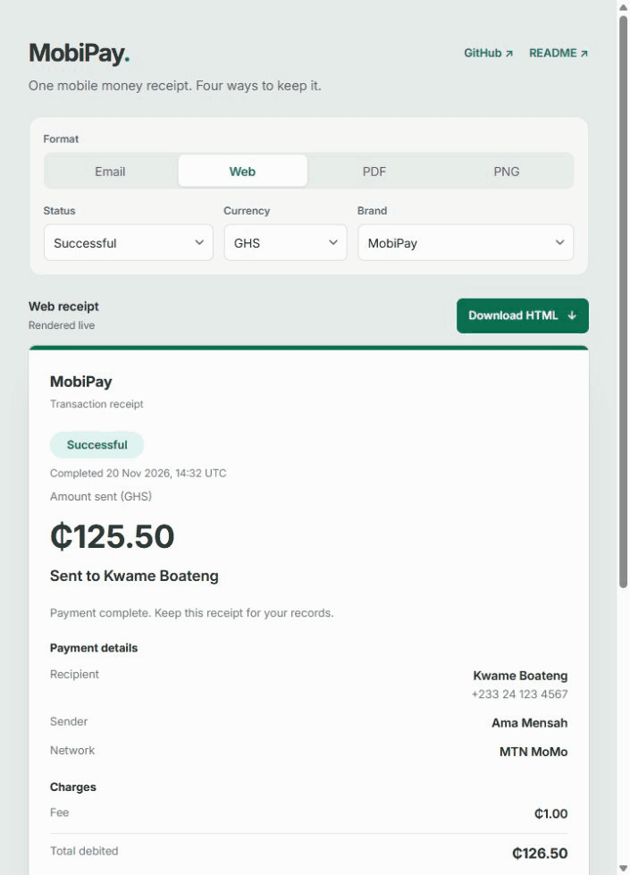

# Hyper Elements submission form

Use the [official submission form](https://github.com/hyper-elements/hyper-elements/discussions/new?category=challenge-submissions). The headings below match its fields. Copy the text under each heading into the corresponding field.

## Title

[Challenge Submission] MobiPay: one mobile money receipt, four formats

## Which challenge are you entering?

Hyper Elements Template Challenge (November 2026)

## Project name

MobiPay

## Project description

MobiPay renders one mobile money receipt as an **email, web page, PDF and PNG** from a single `Transaction`, built with Hyper Elements. It handles successful, pending, failed and reversed payments, with wording that explains what happened and what the sender should do next.

- **Payment details:** recipient name and number, sender, network, fees, reference and note. Initiation, completion and reversal have separate timestamps, displayed in UTC.
- **Wording follows the facts:** a failed payment only says nothing was debited when the data confirms it. Reversed receipts show principal and fee refunds separately; an unknown amount is never treated as zero.
- **Mobile money context:** MTN MoMo and OPay examples, with GHS, NGN and USD sample amounts stored in minor units.
- **Brandable:** a name, an accent colour, a support contact and a footer line. Two sample brands are included.

The demo has phone layouts, downloadable HTML and plain text, PDF and PNG files, and a direct PDF link for browsers without an embedded viewer.

[Compare all four outputs](https://raw.githubusercontent.com/iamIniunam/mobipay/main/docs/formats.png) · [See all four statuses](https://raw.githubusercontent.com/iamIniunam/mobipay/main/docs/statuses.png)

## Public GitHub repository URL

https://github.com/iamIniunam/mobipay

## How did you use Hyper Elements?

The receipt is written once in `src/receipt/body.ts`, as a function of the transaction, brand and font family, using `Column`, `Row`, `Heading`, `Text` and `Link`. Each output wraps that same body in a different root:

| Output | Root | Renderer |
| --- | --- | --- |
| Email | `Email` | `render()` |
| Web page | `Page` | `render()` |
| PDF | `Document` | `renderPdf()` |
| PNG | `Canvas` | `layoutImage()`, then `renderImage()` |

`render()` also runs in the browser, which is how the demo draws the email and web receipts live. The download files are generated in Node for 24 sample combinations: 2 brands × 3 currencies × 4 statuses. Email includes a plain-text version.

A few notes from building with it:

- PDF and PNG use explicit Inter TTF files. Email and web use a font stack, with Inter loaded into the demo's preview frame.
- The PNG export measures the body with `layoutImage()` before drawing it. Strict rendering checks for overflow, so longer names and notes can increase the image height.
- Phone styles apply to the HTML outputs. PDF and PNG use the same body with fixed padding and type sizes.

To run it, use Node 22, clone the repo, then run `npm ci` and `npm run dev`. `npm run render` regenerates the samples. The README includes setup, customisation and renderer details.

Built with React, TypeScript, Vite, `@hyper-elements/react` 0.5.2 and Inter. AI assistance: I used Claude while building the first version, and Codex for review, refinements, testing and submission preparation.

## Live preview URL (optional)

https://iaminiunam.github.io/mobipay/

## Submission confirmation

Complete these in the official form after checking each item:

- [ ] I have starred the Hyper Elements repository.
- [ ] My repository is public and contains the complete source code and required README.
- [ ] My submission meets the requirements of the selected challenge.
